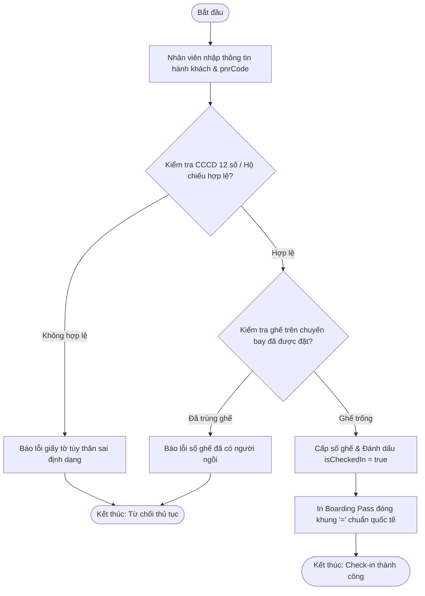

# BÁO CÁO BÀI TẬP: Xây dựng Hệ thống Dòng lệnh Quản lý Hồ sơ Hành khách & Check-in Sân bay

> 👤 **Học viên:** Hoàng Công Dũng | **Mã SV:** PTIT-HCM-009
> 🏫 **Môn học:** it103b-rl-HoangCongDung

---

## 📊 Sơ đồ thiết kế hệ thống (Activity Diagram)

> 💡 *Sơ đồ dưới đây được render tự động trực tiếp trên GitHub bằng Mermaid. Bạn cũng có thể tải file **`bt2.drawio`** trong repository này để mở và chỉnh sửa trực tiếp trên [Draw.io (diagrams.net)](https://app.diagrams.net).* 

---

## 1. Mục tiêu và Bối cảnh bài toán

Bài tập thực hành xây dựng hệ thống quản lý hồ sơ hành khách và thủ tục an ninh hàng không trên nền tảng Javascript dòng lệnh.

Áp dụng cấu trúc dữ liệu Array of Objects để lưu trữ thông tin, kiểm tra tính hợp lệ của CCCD/Hộ chiếu và chống xung đột ghế ngồi trên cùng một chuyến bay.

- Quản lý chính xác mã đặt chỗ pnrCode và trạng thái isCheckedIn của hành khách.
- Xác thực nghiêm ngặt định dạng giấy tờ tùy thân trước khi cho phép qua cửa an ninh.

## 2. Quy tắc nghiệp vụ và Xử lý lỗi biên

Hệ thống kiểm tra kỹ lưỡng các điều kiện đầu vào để đảm bảo không xảy ra tình trạng trùng lặp ghế hoặc chấp nhận giấy tờ giả mạo.

Mã nguồn được viết theo mô hình lập trình hàm đơn nhiệm, dễ bảo trì và mở rộng.

- Số CCCD phải đúng 12 chữ số; Hộ chiếu bắt đầu bằng 1 chữ cái và 7-8 chữ số tiếp theo.
- Không cho phép hai hành khách cùng check-in một số ghế trên cùng một chuyến bay.
- Xuất thẻ lên máy bay (Boarding Pass) định dạng chuẩn khung ký tự '=' trực quan trên console.

---

## 📁 Danh sách tệp tin nộp bài trong Repository
- 📝 `bt2.docx`: Báo cáo tài liệu phân tích nghiệp vụ hoàn chỉnh.
- 🎨 `bt2.drawio`: File thiết kế sơ đồ chuẩn theo quy định đề bài (mở trực tiếp bằng [Draw.io](https://app.diagrams.net) hoặc Lucidchart).
- 💻 `capstone_passenger_records.js`: Mã nguồn chương trình.
